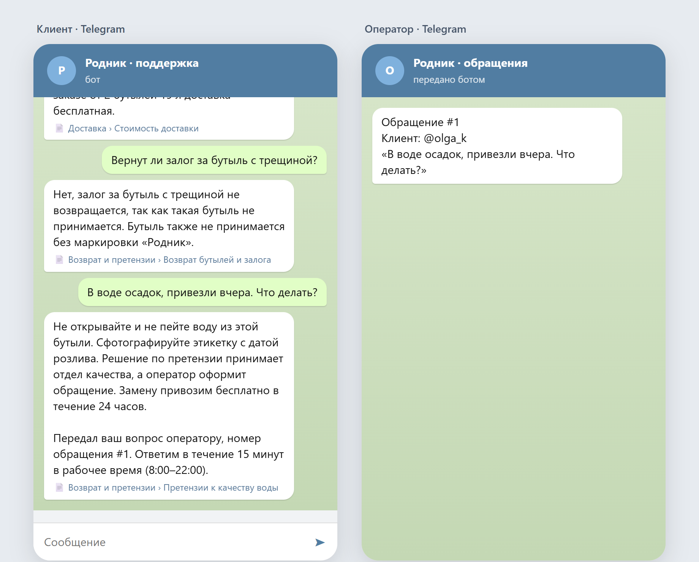
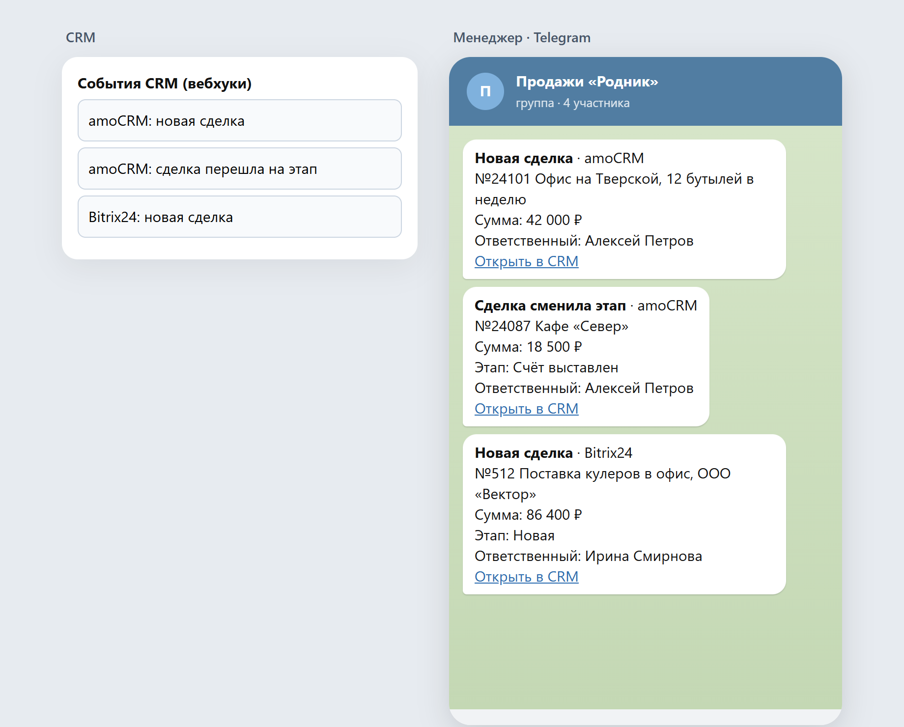
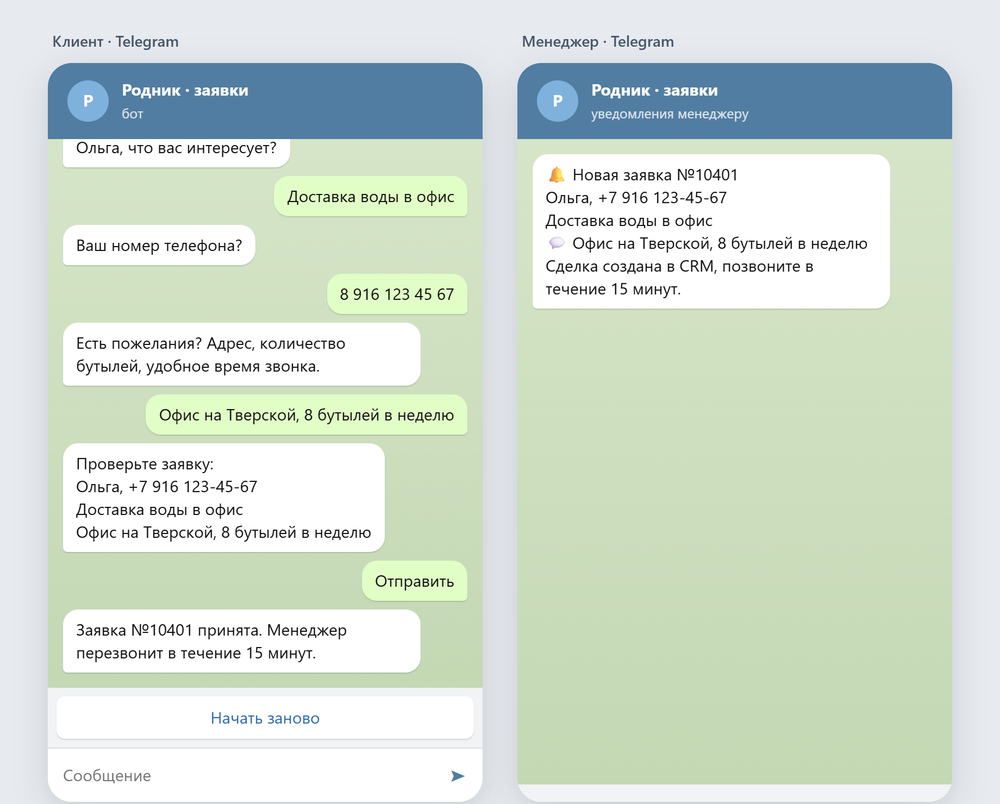

# Демо для портфолио: боты и интеграции

Три небольших рабочих проекта на вымышленной компании «Родник» (доставка воды). Логика каждого бота отделена от мессенджера: один и тот же код работает в Telegram (aiogram) и на веб-стенде для скриншотов.

| Папка | Что делает |
|---|---|
| `support_bot/` | ИИ-бот поддержки: ищет ответ в базе знаний (markdown, BM25), Claude отвечает только по найденным разделам и указывает источник. Если ответа нет или нужен человек, создаёт обращение и передаёт его оператору |
| `crm_notify/` | Приёмник вебхуков amoCRM и Bitrix24: новая сделка или смена этапа → сообщение в Telegram-чат отдела продаж. Повторные вебхуки не дублируются, для Bitrix24 поля сделки дозапрашиваются через REST |
| `leads_bot/` | Бот приёма заявок: имя → услуга → телефон (с проверкой и нормализацией) → комментарий → подтверждение. Создаёт сделку с контактом в amoCRM (API v4, `leads/complex`) и пишет менеджеру |

## Запуск

```bash
python -m venv .venv && .venv/Scripts/pip install -r requirements.txt
.venv/Scripts/python -m pytest -q          # тесты
.venv/Scripts/python -m uvicorn playground:app --port 8000   # стенд: /support, /crm, /leads
```

В Telegram:

```bash
BOT_TOKEN=... OPERATOR_CHAT_ID=... python -m support_bot.bot
BOT_TOKEN=... MANAGER_CHAT_ID=... AMO_SUBDOMAIN=... AMO_TOKEN=... python -m leads_bot.bot
TG_TOKEN=... TG_CHAT_ID=... BITRIX_WEBHOOK=... uvicorn crm_notify.server:app --port 8001
```

LLM: при заданном `ANTHROPIC_API_KEY` используется Anthropic SDK (`LLM_MODEL`, по умолчанию `claude-opus-5-5`), без ключа — локальный Claude Code CLI. Без ключей CRM заявки пишутся в SQLite, а уведомления копятся в памяти — так работает стенд.

## Скриншоты стенда




